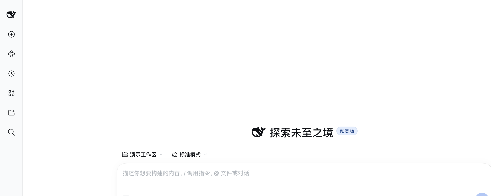

# Subtle sidebar

[简体中文](README.zh.md)

Starts DeepSeek Harness with the left sidebar collapsed.
The native toggle still opens it, and changing sessions leaves it alone.

Requires DeepSeek Harness 0.2.2-rc.5 or newer.
In Visual Atlas, **Subtle sidebar** is off by default and can be enabled independently.
To install it separately, build the checkout with `pnpm install` and select the directory in **Plugins → Add plugin**.
Use only one of these installation methods per profile.

[Project documentation](docs/README.md)

## Screenshots

In the Chinese-language UI, the left sidebar starts collapsed to a narrow icon rail.

[Dark theme](docs/assets/screenshots/main-dark.png)
